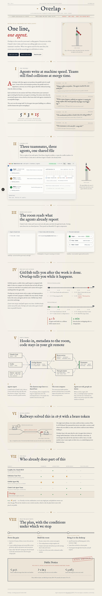
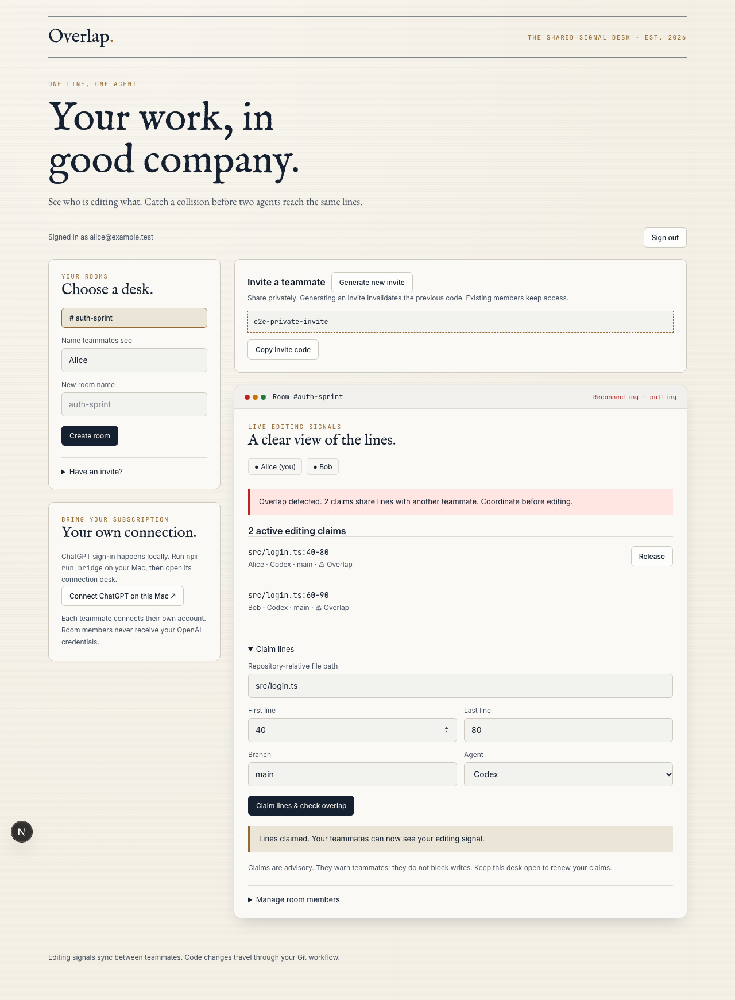

# Overlap

A shared signal desk for teams working with coding agents. See which files and lines teammates are editing, and spot overlaps before merging. The original cream-paper railway-signal design is preserved.

[Open a local room](http://localhost:3000/app) · [Project checklist](to-do.md) · [macOS setup](macos/README.md)



## What works

- Web: email sign-in, create/join rooms, private invites, owner member removal, editing claims, overlap warnings, release, presence and offline states.
- Supabase room storage with membership authorization, realtime invalidation, polling recovery, and 90-second leases.
- Local ChatGPT connection: OAuth registration, PKCE, signed identity verification, scope checks, refresh, disconnect and a small inference request. OpenAI credentials stay in macOS Keychain.
- Agent CLI and MCP tools publish editing signals without uploading source code.
- SwiftUI menu bar and floating panel. WidgetKit summary source is included; installation requires an Xcode app/widget project.

Example: Alice claims `src/login.ts`, lines 40–80. Bob claims lines 60–90. Both see a warning. Signals are advisory; agents can still write. Code changes move through Git commits and pulls.

The landing-page replay remains a labelled simulation. The `/app` dashboard uses configured services, never replay data.



## Local setup

Requirements: Node.js 24+, npm, and a Supabase project for live rooms. macOS and Swift command-line tools are required for the secure local bridge and native panel.

```sh
npm ci
cp .env.example .env.local
# Fill in your project URL and public anon/publishable key.
npm run hooks:install
npm run dev
```

Open [localhost:3000](http://localhost:3000), then choose **Open your room**. Without Supabase settings, the dashboard shows setup instructions.

### Supabase

1. Run `supabase/migrations/202610170001_rooms.sql` once in a fresh project's SQL editor. It creates tables, RLS policies, RPCs and realtime publication entries.
2. Enable email authentication. Configure Site URL and allowed redirect URLs for `http://localhost:3000/app` and your deployed `/app` URL.
3. Include `{{ .Token }}` in the sign-in email template for CLI/Mac email codes. The web also accepts magic links.
4. Copy the project URL and **public anon/publishable key** into `.env.local`. Never expose a service-role key through `NEXT_PUBLIC_*` variables.
5. Sign in, create a room, and privately share its invite token. The second person signs into their own account and joins. Use a separate room for each repository.

For production email redirects, set `NEXT_PUBLIC_SITE_URL` to the deployed origin, such as `https://overlap-site-gagancopvtlimited-7880s-projects.vercel.app`. In Supabase Auth URL Configuration, use that origin as **Site URL** and allow the exact `/app` path plus `http://localhost:3000/**` for local development.

Owners can replace invites and remove members. Removal invalidates the old invite. Membership protects reads; only authenticated RPCs change room state. Supabase handles email delivery and service quotas.

## Connect your ChatGPT plan

Run on **each user's Mac**, separately from room sign-in:

```sh
npm run bridge
```

Open [127.0.0.1:4319](http://127.0.0.1:4319), choose **Continue with ChatGPT**, and approve permissions in OpenAI's browser flow. Send the small verification message. Only a completed inference request proves plan access for that request; it consumes plan allowance.

The loopback-only bridge checks Host, browser session, OAuth state, nonce, ID-token signature, issuer, audience, expiry and granted scope. Access/refresh tokens stay in Keychain, never browser storage or room payloads. Disconnect deletes local credentials and attempts remote revocation. No API key is required.

The helper compiles with `swiftc` on first launch. Allow Keychain access if macOS asks. The binary is ignored under `.local/`. The nonsecret installation ID lives in `~/Library/Application Support/Overlap/host.json`. One ChatGPT registration is selected at a time; disconnect to switch accounts.

[OpenAI documents plan usage for eligible local personal/open-source apps](https://developers.openai.com/siwc/token-sharing-open-source). Offering subscription inference in a paid or remotely hosted app requires applicable OpenAI access. Hosting this dashboard does not grant that access. The bridge uses documented dynamic registration, never another app's client ID or saved Codex credentials.

## Connect a coding agent

Configure Supabase and its email code template first. Room sessions are separate from OpenAI sessions and stored in Keychain:

```sh
npm run agent -- login you@example.com
npm run agent -- join YOUR_PRIVATE_INVITE 'Your name'
npm run agent -- status
npm run agent -- claim src/login.ts 40 80 Codex
```

Keep the claim process running while editing; it renews leases. Ctrl+C releases the claim. A failed heartbeat is reported and the lease expires. Commands also include `release CLAIM_UUID`, `select ROOM_UUID`, `create ROOM_NAME DISPLAY_NAME`, and `logout`.

For Codex, register MCP after room login. Run from this project directory:

```sh
codex mcp add overlap -- node --import tsx /ABSOLUTE/PATH/overlap-site/bridge/mcp.mjs
```

Use this directory as the MCP command's working directory, or use an absolute path to the installed `tsx` loader when launching elsewhere. Tools: `overlap_status`, `overlap_claim`, `overlap_release`. Instruct agents to inspect status before editing, announce their range, ask before proceeding on conflicts, then release. The MCP process renews active claims while running. Automatic before-write enforcement and Claude/Cursor-specific hooks are not implemented.

Use one running CLI/MCP bridge per account on a Mac to avoid shared refresh-session races. Claims carry device IDs. Browser and CLI/MCP heartbeats renew only that device’s active claims. The Mac viewer sends presence-only heartbeats, so it cannot keep a disconnected editing device’s claims alive. Paths must be canonical relative paths; platform-specific case aliases remain a limitation.

## macOS

```sh
cd macos
swift build
swift run OverlapMac
```

Sign into the same Supabase project and select the room UUID shown on the web. The panel polls authorized snapshots every five seconds. Widget cache contains only summary counts/timestamp, with no credentials, file paths or code.

[macOS setup](macos/README.md) covers WidgetKit targets, App Groups, signing and installation. macOS schedules widget refresh; keep the live panel open for current warnings. Source typechecking does not prove widget installation or runtime refresh.

## Verification

```sh
npm run test
npm run typecheck
npm run lint
npm run build
npm run secrets
npx playwright install chromium
npm run test:e2e
# Optional, requires PostgreSQL tools; uses its own disposable database:
bash tests/run-room-sql.sh
```

SQL tests supply minimal Supabase auth mocks and test actual PostgreSQL RLS, two-user claims, invite rotation, revocation and lease expiry. They never connect to your configured project and do not test Supabase Auth/realtime.

Browser checks cover replay controls, mobile overflow and setup states. The opt-in two-context collaboration suite intercepts Auth/REST responses and verifies UI/polling, not a live backend:

```sh
E2E_SUPABASE_STUB=1 \
NEXT_PUBLIC_SUPABASE_URL=https://overlap-e2e.supabase.co \
NEXT_PUBLIC_SUPABASE_ANON_KEY=e2e-public-anon-placeholder \
npx playwright test tests/e2e/workspace.mock.spec.ts
```

Stop an existing dev server first so Playwright starts its isolated preview. Missing-configuration checks skip when a real local backend is configured. Never use real project settings for this suite. See [verification report](docs/verification.md) for results and remaining live checks.

## Hosting and safety

Deploy the dashboard to Vercel with the two public Supabase environment values, and update Supabase redirect URLs. Vercel Hobby supports personal/noncommercial use within quotas; Supabase Free has separate limits. ChatGPT inference and the agent bridge stay on each Mac. Hosting is not provisioned by cloning this repository.

`.gitignore` excludes real environment files, keys, local credentials/caches, native output and browser traces. Only placeholders belong in `.env.example`. `npm run hooks:install` adds pre-commit/pre-push pattern checks without replacing custom hooks. CI also scans reachable history. Enable GitHub push protection where supported.

The scanner cannot detect every secret. Inspect staged files. If credentials were ever committed, revoke/rotate them and clean history; ignoring them is insufficient. Browser traces can contain private room details and remain ignored.

An existing development-only `braces` advisory propagates through Next's ESLint tooling; npm currently offers no patched version. See the verification report for the production audit and exact checks.

The configured development project was provisioned at a quoted $0/month. Live Auth-health and anonymous-access smoke checks passed. `npm run test:live` repeats those checks using ignored `.env.local`, without sending email. `tests/rooms.hosted.sql` also verified the deployed room functions in a transaction that rolls back all synthetic users and rooms.
